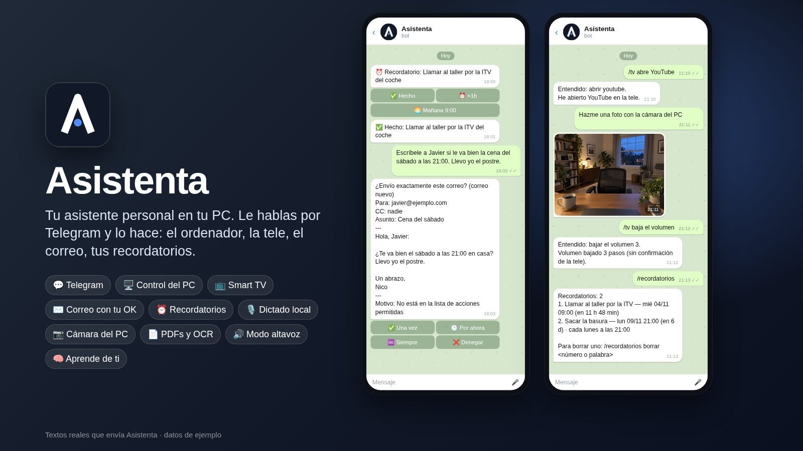
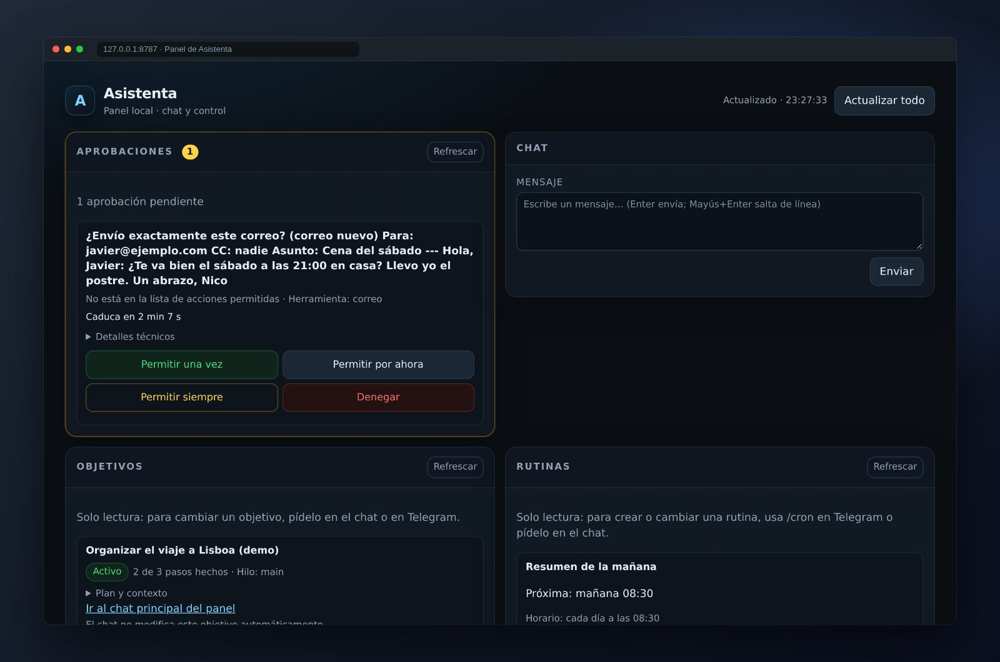
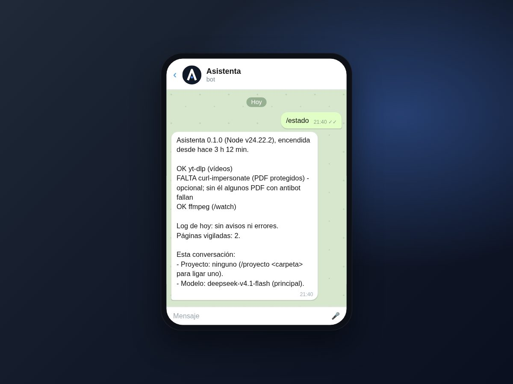
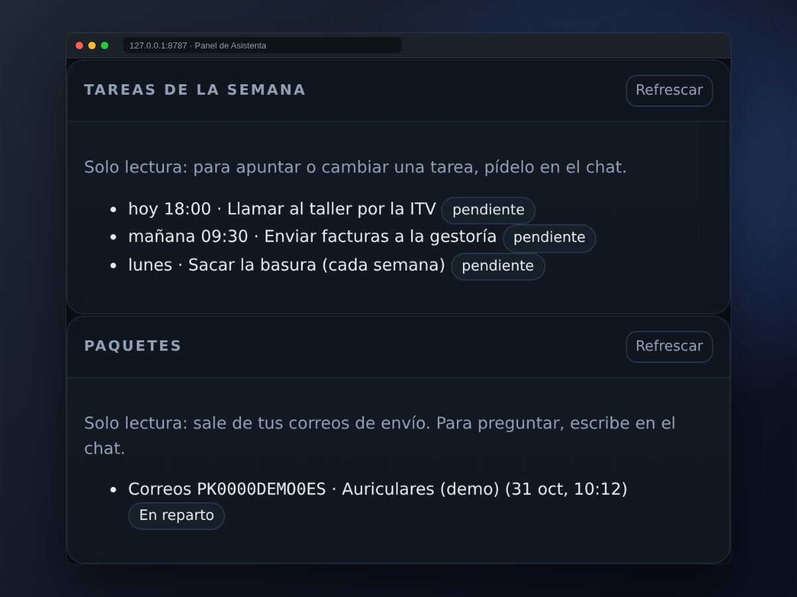
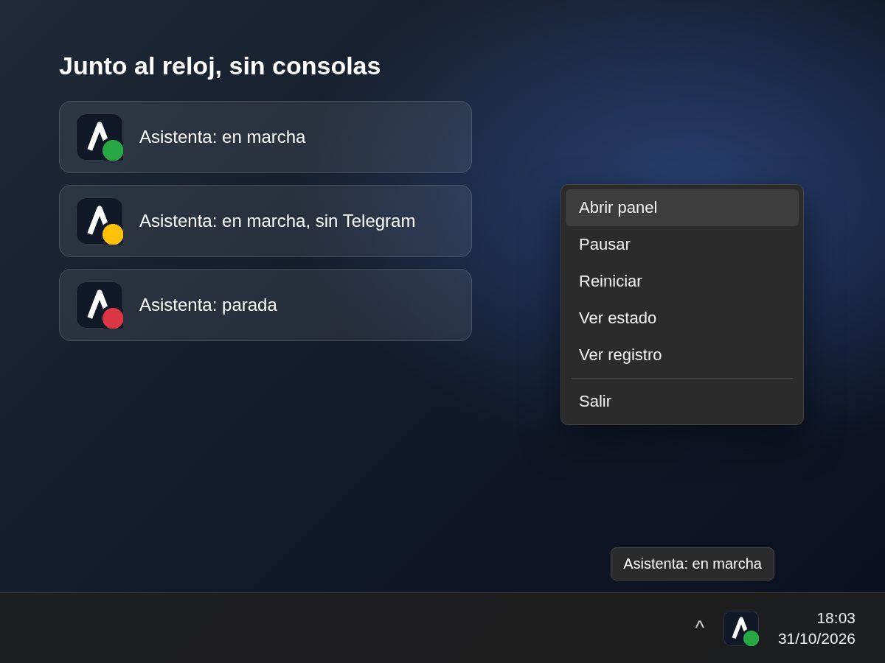

# Asistenta

<p align="center"></p>

<p align="center"><b>Tu asistente personal en tu PC. Le hablas por Telegram y lo hace: el ordenador, la tele, el correo y tus recordatorios.</b></p>

<p align="center">

[](https://github.com/nicogarrr/asistenta/actions/workflows/ci.yml)
[](https://github.com/nicogarrr/asistenta/actions/workflows/windows.yml)
[](LICENSE)
[](package.json)
[](docs/app-windows.md)
[](#desarrollo-y-qa)

</p>

> Idioma: **Español** | [English](README.md)

> **Estado:** proyecto en desarrollo. Tener una función en el código no garantiza que esté configurada ni validada en tu equipo. Los mensajes que recibe el proveedor LLM salen hacia ese proveedor. Los nombres de presets no garantizan cuota ni precio cero.

- **Qué resuelve:** un asistente que hace cosas de verdad (no solo chatear) mientras tus datos, claves y aprobaciones se quedan en tu máquina.
- **Para quién:** gente que quiere su propio agente personal y no se asusta de crear un bot de Telegram y una clave de un proveedor LLM.
- **Coste:** todo es gratis menos la clave del modelo, que tu proveedor cobra por uso.

## Un vistazo rápido

<p></p>

**Telegram para hablarle, el panel local para verlo todo.** Las aprobaciones, el chat, los objetivos, las rutinas, las tareas y los paquetes están en un mismo sitio, en tu PC.

<table>
  <tr>
    <td width="33%"></td>
    <td width="33%"></td>
    <td width="33%"></td>
  </tr>
  <tr>
    <td><b>/estado</b><br/>Cómo está Asistenta, qué herramientas tiene listas y qué modelo usa, sin gastar tokens.</td>
    <td><b>Tu semana</b><br/>Tareas con día y hora y los paquetes que esperas, con su número de seguimiento.</td>
    <td><b>Junto al reloj</b><br/>Verde: en marcha y con Telegram. Ámbar: sin Telegram. Rojo: parada. Sin ventanas de consola.</td>
  </tr>
</table>

<sub>Todo con datos inventados. El panel es el panel real (<code>src/webui</code>) servido en local con datos de ejemplo. Los chats de Telegram reproducen los textos exactos que genera el código (recordatorio, aprobación de correo, <code>/tv</code>, <code>/recordatorios</code> y <code>/estado</code>); el marco del móvil es un dibujo y la foto de la cámara es una imagen de ejemplo generada. Los iconos de la bandeja están dibujados con los mismos colores y el mismo menú que <code>scripts/windows-app/bandeja.ps1</code>. Ninguna cuenta ni dato real.</sub>

## Lo que la hace distinta

- **Usa tu PC de verdad.** Ve la pantalla y maneja ratón y teclado: abre programas, hace clic y escribe por ti (Computer Use).
- **La tele, desde el chat.** Enciende tu tele LG con Wake-on-LAN y maneja apps, volumen y canales. Las órdenes simples con `/tv` van al momento y sin gastar tokens del modelo.
- **Modo altavoz.** `/altavoz pc` o `/altavoz tele`: cada nota de voz que mandas suena sola al llegar, en el PC o en la tele.
- **La cámara del PC cuando quieras.** «Hazme una foto con la cámara del PC» y te llega al chat. También vídeos cortos.
- **Dictado en cualquier programa.** Mantén la tecla, habla y suelta: el texto aparece donde está el cursor, transcrito en tu propio PC.
- **OCR local.** Lee PDFs escaneados y fotos en tu PC, sin nube.
- **Aprende de tus correcciones.** Dile «no, prefiero…» y lo guarda como regla para la próxima vez. De noche fusiona recuerdos repetidos, con copia antes.
- **Se hace nuevas funciones.** Pide una función con tus palabras: te la propone y solo la hace tras tu «sí». Cuando una tarea de varios pasos sale bien, ofrece guardarla como habilidad.
- **Correo con tu OK.** Ves el borrador exacto (para, asunto y texto) antes de que salga. Las reglas de correo con tus palabras («lo de LinkedIn a la papelera») siempre te enseñan la lista antes de actuar.
- **Paquetes y tu semana de un vistazo.** Sigue los repartos de tu correo y enseña tareas y paquetes en el panel.
- **Respeta tus horas.** «No me escribas antes de las 9» vale también para sus propios avisos. Resumen de la mañana opcional (`PA_BRIEFING=1`).
- **Recordatorios naturales.** «Cada dos semanas», «de lunes a viernes»… y llegan con botones para posponer.
- **Los secretos no llegan al modelo.** Las claves viven en un almacén local en tu PC.
- **Se actualiza sola, sin riesgo.** Si una actualización se queda a medias, vuelve sola a la versión anterior.

## Índice

- [Lo que la hace distinta](#lo-que-la-hace-distinta)
- [Qué es y cómo funciona](#qué-es-y-cómo-funciona)
- [Empieza aquí (Windows)](#empieza-aquí-windows-10-minutos) · [Instalador .exe](#instalador-exe-recomendado)
- [Qué puedes hacer](#qué-puedes-hacer)
- [Qué es gratis](#qué-es-gratis)
- [Comandos útiles](#comandos-útiles)
- [Configuración esencial](#configuración-esencial-env)
- [Seguridad y privacidad](#seguridad-y-privacidad)
- [Preguntas frecuentes y problemas](#preguntas-frecuentes-y-problemas)
- [Quitar Asistenta del PC](#quitar-asistenta-del-pc)
- Instalación a mano: [Antes de empezar](#antes-de-empezar) · [Preparar el código](#preparar-el-código) · [Configuración sin secretos](#configuración-sin-secretos) · [Secretos y Telegram](#secretos-y-telegram) · [Comprobar y arrancar](#comprobar-y-arrancar)
- [Panel web local](#panel-web-local) · [Arranque automático](#arranque-automático) · [OCR local](#ocr-local-opcional) · [Dictado por voz](#dictado-por-voz-en-cualquier-app-opcional)
- [Desarrollo y QA](#desarrollo-y-qa) · [Cómo está organizado](#cómo-está-organizado) · [Contribuir](#contribuir) · [Licencia y créditos](#licencia-y-créditos)

## Qué es y cómo funciona

Asistenta es un asistente personal de código abierto que vive en tu PC con Windows. Le hablas desde tu bot privado de Telegram (texto o notas de voz) y actúa: usa el ordenador, la tele, tu correo, tus recordatorios y tus documentos. Solo te obedece a ti, y lo delicado (enviar un correo, abrir una web nueva, tocar archivos) te lo pregunta antes con botones. El daemon corre en tu máquina; el panel web local ofrece chat, aprobaciones, sesiones, memoria, estado y auditoría, y comparte el flujo de permisos de Telegram. Las funciones de escritorio necesitan una sesión Windows interactiva.

```text
Tú en Telegram  <-->  Asistenta (en tu PC)  <-->  proveedor LLM (lo único de pago)
                             |
                  panel web local (loopback + token):
                  chat, aprobaciones, memoria, estado, auditoría
                             |
      herramientas: navegador, escritorio Windows, voz, OCR, correo,
      calendario, recordatorios, rutinas, objetivos, tele, iPhone
```

## Empieza aquí (Windows, 10 minutos)

En esta guía `pa` es lo mismo que `node dist\cli.js`, dentro de la carpeta de Asistenta.

1. Instala Node 24 o más nuevo, gratis, desde https://nodejs.org.
2. Descarga Asistenta. Mejor con git, así se actualiza sola: `git clone https://github.com/nicogarrr/asistenta` (si Windows dice que «git» no se reconoce, instálalo gratis desde https://git-scm.com y abre otra ventana). También vale «Code → Download ZIP» (descomprímelo antes de abrir nada), pero entonces no se actualiza sola: para una versión nueva vuelve a bajar el ZIP. Ponla fuera de OneDrive (por ejemplo en `C:\Asistenta`): OneDrive bloquea archivos y la instalación falla.
3. En Telegram habla con @BotFather, crea tu bot con `/newbot` y copia el token que te da.
4. Saca la clave del modelo en la web de tu proveedor (por defecto OpenCode). Es lo único de pago.
5. Con internet, haz doble clic en `instalar.bat`. Comprueba Node y npm, descarga las piezas, instala, compila y te pide el token y la clave (no se ven al pegarlos). Si sale «Windows protegió su PC», pulsa «Más información» y luego «Ejecutar de todas formas».
6. Cuando te lo pida, mándale «hola» a tu bot y confirma en el PC que eres tú. Así solo tú podrás hablarle.
7. Haz doble clic en `levantar.bat`. Si falta algo, verás una lista en verde y rojo con el arreglo de cada fallo.
8. Escríbele a tu bot. Ya está.
9. Opcional: para que arranque sola con Windows, `node dist\cli.js autostart install --start` ([detalles](docs/windows-startup.md)).

Si algo se tuerce, `node dist\cli.js iniciar --solo-comprobar` dice qué falta sin arrancar nada.

### Instalador .exe (recomendado)

Con el instalador `Asistenta-Instalador-<versión>.exe` no hace falta Node ni consolas: siguiente, siguiente, listo. Instala sin administrador, sale en «Agregar o quitar programas», puede arrancar sola con el PC y deja un icono junto al reloj (abrir panel, pausar, reiniciar, ver estado). Cómo crearlo y usarlo: [docs/app-windows.md](docs/app-windows.md). Los pasos con `instalar.bat` siguen valiendo igual.

Para quitarla si la instalaste así: Configuración → Aplicaciones → Asistenta → Desinstalar. Tus datos y claves se quedan salvo que marques la casilla de borrarlos.

## Qué puedes hacer

Pídeselo con tus palabras, por texto o por voz. Algunos ejemplos:

### El ordenador (Computer Use)

«Abre el Excel de gastos y dime el total de octubre», «busca el PDF de la factura de la luz y mándamelo». Ve la pantalla, mueve el ratón, escribe y usa un navegador real. Lo que sale fuera del PC o toca algo delicado pasa antes por tu aprobación. Necesita Windows con sesión iniciada; en Linux usa `PA_DESKTOP=off`.

### La tele

«Pon la uno», «baja el volumen a la mitad», «abre Netflix». Teles LG con webOS: encender por red, volumen, canales y apps. Las órdenes sencillas son directas y no gastan modelo (`/tv`). Guía: [docs/tv-ordenes.md](docs/tv-ordenes.md).

### Correo

«¿Tengo correos del banco?», «contesta al del taller que lo miro el lunes». Lee y envía desde tu propio Gmail. Antes de enviar te enseña el correo exacto (para, asunto y texto) y espera tu sí. Guía: [docs/correo.md](docs/correo.md).

### PDFs, fotos y OCR

Mándale un PDF escaneado o una foto de un documento y te lo devuelve con el texto seleccionable, todo en tu PC y sin coste. Revisa las tablas sin IA. Guías: [docs/ocr-telegram.md](docs/ocr-telegram.md), [docs/pdf-texto.md](docs/pdf-texto.md) y [OCR local](#ocr-local-opcional).

### Recordatorios, tareas y paquetes

«Recuérdame mañana a las 18:00 llamar al taller», «los lunes, sacar la basura». El aviso llega con botones (✅ Hecho, ⏰ +1h, 🌅 Mañana 9:00) y si el PC estaba apagado te lo da al volver. También sigue tus paquetes, vigila precios («avísame si baja de 400 €») y, si lo activas, te manda un resumen por la mañana que respeta tus horas de silencio. Guías: [docs/recordatorios.md](docs/recordatorios.md), [docs/vigilar-precio.md](docs/vigilar-precio.md) y [docs/resumen-diario.md](docs/resumen-diario.md).

### Dictado por voz

Mantén una tecla, habla y suelta: escribe donde tengas el cursor, en cualquier app. Local, gratis y sin guardar audio. Ver [Dictado por voz](#dictado-por-voz-en-cualquier-app-opcional).

### REA: ver cómo funciona una app por dentro

Si tienes [REA](https://github.com/morluto/rea) instalado (`npm install --global rea-agents`), Asistenta lo usa para analizar programas de Windows, apps Electron, .NET y webs. `PA_REA=0` lo apaga. Guía: [docs/rea.md](docs/rea.md).

### Aprende contigo

Recuerda lo que le cuentas (memoria persistente que puedes ver en el panel), le puedes pedir funciones nuevas hablando (te pregunta sí/no antes de hacerlas) y, ante una tarea grande, te hace antes unas preguntas para hacerlo a tu manera. Guía: [docs/skills-matt.md](docs/skills-matt.md).

### Resumen y condiciones

| Área | Qué incluye | Condiciones |
| --- | --- | --- |
| Conversación | Telegram y chat en el panel local | Bot, usuario autorizado y proveedor configurados |
| Memoria | Contexto persistente, sesiones y búsqueda | El contenido y su alcance dependen de la configuración |
| Objetivos | Plan propuesto, activación humana, pasos y ejecución programada | Límites de objetivos activos y de ejecuciones diarias |
| Navegador y escritorio | Herramientas web y control del ordenador | Escritorio en Windows; sitios, acceso y permisos propios |
| Aprobaciones | Decisiones pendientes en Telegram y en el panel | No sustituye la revisión del resultado ni autoriza cualquier acción |
| Dictado por voz | Dictado pulsando una tecla en cualquier app de tu PC, todo en local | Apagado por defecto; Windows con sesión interactiva; `PA_DICTADO=1` |
| Tareas y recordatorios recurrentes | «los lunes», «cada dos semanas», «la semana que viene», «el mes que viene» | Programación en lenguaje natural con recuperación tras apagado |
| Pedir funciones hablando | Pídele una función nueva hablando; propone y valida los cambios ella misma | Solo se promueve con la checklist de verificación completa |
| Funciones opcionales | Voz, correo, TV y control de iPhone | Requieren sus dependencias, equipos y configuración; no se activan al instalar el chat |

### Un objetivo, de principio a fin

1. Describe lo que quieres conseguir y sus límites.
2. Asistenta propone un plan. Solo se activa después de la confirmación humana y de pasar por los permisos correspondientes.
3. Ejecuta los pasos en su cadencia, guarda el avance y comunica novedades o bloqueos.
4. Si falta una decisión, se detiene para pedirla. Un paso marcado como completado no certifica por sí solo la calidad del resultado.

Los objetivos se guardan en SQLite con su ámbito de conversación. El panel incluye una **vista de solo lectura de los objetivos del propietario**, con sus estados, bloqueos y pasos. No permite activar, pausar ni cancelar objetivos desde esa vista. Un tablero editable y un estado separado de revisión serían trabajo futuro, no capacidades disponibles por esta guía.

## Qué es gratis

Lo único de pago es **la clave del modelo**: tu proveedor te cobra por uso según su plan. Todo lo demás es gratis y corre en tu PC:

- el programa, el bot de Telegram y el panel web local;
- la memoria, los recordatorios, las rutinas y los objetivos;
- la búsqueda web (por defecto solo usa buscadores gratis: `PA_WEB_MAX_COST_EUR=0`);
- la transcripción de voz y el OCR, que funcionan en local;
- el control del PC y de la tele, el correo con tu propia cuenta y el calendario;
- el arranque automático, el vigilante y la autoactualización.

Ninguna otra función necesita una clave de pago.

## Comandos útiles

En Windows, `pa` es lo mismo que `node dist\cli.js` dentro de la carpeta de Asistenta.

| Comando | Para qué |
| --- | --- |
| `pa iniciar` | Comprueba todo y arranca. Con `--solo-comprobar`, solo dice qué falta (lista verde y roja) |
| `pa stop` | La apaga; el vigilante no la vuelve a levantar hasta `pa iniciar` o el siguiente reinicio |
| `pa doctor` | Revisa el entorno (Node, Telegram, claves, panel, zona horaria…) y dice qué falta |
| `pa panel` | Abre el panel web en el navegador, ya con su token |
| `pa diagnose` | Junta evidencia local para ver qué ha pasado (revísala antes de compartirla) |
| `pa autostart install --start` | Arranca sola con Windows y deja el vigilante; `status` y `uninstall` para verlo y quitarlo |
| `pa autoupdate status` | Cómo fue la última actualización automática; también `now`, `off` y `on` |
| `pa dictado prueba` | Prueba el micrófono y el dictado sin escribir nada |
| `pa backup` | Lista las copias diarias; `pa backup restaurar ultima` vuelve a la última ([guía](docs/copias-de-seguridad.md)) |
| `pa vault list` | Nombres de las claves guardadas, nunca sus valores |
| `pa tv mac auto` | Lee la MAC de la tele para poder encenderla por red |

En Telegram: `/estado` (salud de Asistenta), `/recordatorios` (lista y borra sin gastar tokens), `/tv` (mando de la tele) y `/help` (todas las órdenes).

## Configuración esencial (.env)

`instalar.bat` crea el `.env` por ti. Las claves (token del bot y clave del modelo) **no** van en el `.env`: se guardan cifradas en la caja fuerte de Windows. Lo más habitual de tocar:

| Variable | Qué hace |
| --- | --- |
| `PA_PROVIDER_PRESET` | Proveedor del modelo (por defecto `opencode`; también `openrouter` y `opencode-local`) |
| `PA_MODEL` | Modelo principal |
| `PA_TIMEZONE` | Tu zona horaria para recordatorios, por ejemplo `Europe/Madrid` |
| `PA_DESKTOP` | `off` para no usar el control del escritorio (Linux o servidor) |
| `PA_WEB_PORT` y `PA_WEB_TOKEN` | El [panel web](#panel-web-local) ya viene encendido en `127.0.0.1:8787` con un token propio; `PA_WEB_PORT=0` lo apaga y tu propio `PA_WEB_TOKEN` (24+ caracteres al azar) solo hace falta para abrirlo desde el móvil |
| `PA_DICTADO` | `1` enciende el dictado por voz |
| `PA_OCR_LOCAL` | `1` enciende el OCR local |
| `PA_BRIEFING` | `1` enciende el resumen de la mañana |
| `PA_REA` | `0` apaga REA |
| `PA_AUTOUPDATE` y `PA_WATCHDOG` | `0` apagan la autoactualización y el vigilante |
| `PA_STATE_DIR` | Otra carpeta para tus datos (por defecto, en tu perfil de usuario) |

Todas las opciones, comentadas, están en [`.env.example`](.env.example). Más detalle en [Configuración sin secretos](#configuración-sin-secretos).

## Seguridad y privacidad

- **Solo te obedece a ti.** Al instalar, le mandas «hola» a tu bot y confirmas en el PC que eres tú; a cualquier otra persona no le hace caso.
- **Lo delicado, con tu OK.** Enviar un correo, abrir una web nueva o cualquier acción fuera de la lista de permitidas se pregunta con botones (una vez, por ahora, siempre o denegar), en Telegram y en el panel.
- **Tus claves no salen del PC.** Se guardan en la caja fuerte de Windows (DPAPI), nunca se mandan al modelo y `pa vault list` solo enseña nombres.
- **El panel solo es tuyo.** Escucha en `127.0.0.1`, pide token y rechaza cualquier otro nombre de host.
- **Lo que sí sale:** los mensajes que le mandas al modelo van a tu proveedor LLM, con sus condiciones.

### Límites

- No uses datos, cuentas ni sesiones reales en pruebas automatizadas.
- No subas secretos, directorios de estado, capturas privadas ni logs sin revisar.
- El almacén portable no equivale al cifrado DPAPI de Windows. Revisa [la entrada segura por stdin](docs/vault-stdin-qa.md).
- Navegar, ejecutar una herramienta y obtener un resultado son hechos distintos. Una prueba con mocks o en Linux no certifica el control del escritorio Windows.
- Los servicios externos tienen sus propios términos, cuotas y políticas de datos. Revisa el plan antes de activar una clave o una integración.
- Puerta de exfiltración: en cuanto un turno lee algo privado (archivos, memoria, correo, documentos, pantalla, terminal…), una petición de `fetch`, `download` o del navegador con datos (query, ruta larga, usuario en la URL o subdominio largo) a un dominio que el turno aún no ha visitado pide aprobación enseñando la URL completa. Antes de leer nada privado, navegar sigue siendo libre. `PA_TAINT_GATE=0` la apaga.
- El código de delegación no se presenta aquí como un sistema multiagente operativo: su existencia no prueba conexión al daemon.

## Preguntas frecuentes y problemas

**Al instalar sale «Windows protegió su PC».** Pulsa «Más información» y luego «Ejecutar de todas formas». Pasa con programas nuevos que Windows aún no conoce.

**La instalación falla con archivos bloqueados.** Casi siempre es OneDrive o el antivirus. Pon la carpeta fuera de OneDrive (por ejemplo en `C:\Asistenta`) y vuelve a ejecutar `instalar.bat`.

**El bot no contesta.** Mira el icono junto al reloj: rojo es que está parada (`pa iniciar`), ámbar que no llega a Telegram (revisa la conexión). Si sigue, `pa iniciar --solo-comprobar` dice qué falta y `pa doctor` revisa el resto.

**Me avisa «No he podido actualizarme».** Ha intentado actualizarse sola, la versión nueva no arrancó a tiempo y volvió a la anterior, así que sigue funcionando. `pa autoupdate status` dice qué pasó. Para actualizar a mano: `pa stop`, `git pull`, `npm ci`, `npm run build` y `levantar.bat`.

**El panel web no se abre.** Ábrelo con `pa panel` o con «Abrir panel» en el icono de la bandeja: entra ya con su token. Si dice que está apagado, quita `PA_WEB_PORT=0` del `.env` y reinicia Asistenta; `pa doctor` dice qué le pasa. Para abrirlo desde el móvil fuera de casa: [docs/panel-remoto.md](docs/panel-remoto.md).

**¿Cuánto cuesta?** Solo la clave del modelo. Ver [Qué es gratis](#qué-es-gratis).

**¿Puedo tenerla en Linux?** El chat, la memoria, los recordatorios y el panel sí, con `PA_DESKTOP=off`. El control del escritorio, el dictado y la bandeja son de Windows. Sigue [la instalación a mano](#antes-de-empezar).

## Quitar Asistenta del PC

1. Apágala: cierra la ventana de `levantar.bat` o escribe `node dist\cli.js stop`.
2. Si pusiste el arranque con Windows, quítalo antes de borrar nada: `node dist\cli.js autostart uninstall`. Si borras la carpeta primero, Windows sigue intentando arrancarla cada pocos minutos; entonces abre el Programador de tareas y borra `personal-agent-daemon`, `browserd-sidecar` y `Asistenta-vigilante`.
3. Borra la carpeta de Asistenta.
4. Tus datos (memoria, conversaciones y la caja fuerte de claves) están aparte, en `%USERPROFILE%\.local\share\personal-agent` (o en `PA_STATE_DIR` si lo cambiaste). Bórrala solo si no vas a volver.
5. Si no vas a volver, anula el token del bot en @BotFather (`/revoke`) y la clave del modelo en la web de tu proveedor.

## Antes de empezar

Esto y lo que sigue es la instalación a mano (Linux o avanzada). En Windows basta con [Empieza aquí](#empieza-aquí-windows-10-minutos).

- Node.js 24 o posterior y npm. El proyecto exige esa versión en `package.json`.
- Git para obtener el código.
- Un bot de Telegram y tu identificador numérico de usuario.
- Acceso a un proveedor compatible. Los nombres de modelos y los presets del código no garantizan cuota ni precio cero.
- Windows con sesión interactiva para control de escritorio. En Linux o sin escritorio, usa `PA_DESKTOP=off`; no supone cobertura de todas las funciones de Windows.

No uses una cuenta o sesión real para pruebas automatizadas. No pegues claves en incidencias, chats ni capturas.

## Preparar el código

Desde la raíz del repositorio:

```sh
node --version
npm ci
npm run build
node dist/cli.js --help
```

En los comandos siguientes se usa `node dist/cli.js` para no depender de un `pa` instalado globalmente. La compilación crea `dist/`; no descarga ni inicia un proveedor LLM. Algunas dependencias pueden descargar binarios al instalarse. Para el navegador Chromium incluido:

```sh
npx playwright install chromium
```

Con `PA_DESKTOP=off`, `doctor` omite los chequeos de escritorio Windows (pantalla, cámara, micrófono, ventanas). Instala también las dependencias de sistema que Playwright indique para tu plataforma. No hace falta instalar browserd, Docker ni funciones de TV para el chat básico.

## Configuración sin secretos

Copia `.env.example` a `.env` y ajusta solo las opciones que necesites. El CLI carga el `.env` del directorio de trabajo mediante el parser de Node antes de cargar la configuración. Las variables ya presentes en el entorno tienen prioridad. Puedes pasar el archivo expresamente para hacer visible qué configuración usas:

```sh
node --env-file=.env dist/cli.js doctor
```

El archivo de ejemplo no contiene claves. No subas `.env` ni el directorio de estado al repositorio. Si eliges otra carpeta con `PA_STATE_DIR`, usa la misma para todos los comandos y para el arranque automático.

El preset por defecto del código es `opencode`. También existen `openrouter` y `opencode-local`; este último requiere un servidor OpenCode ya configurado, accesible en la URL local seleccionada y con su jaula validada. Esta guía no lo instala ni cambia de proveedor automáticamente.

## Secretos y Telegram

El almacén por defecto usa DPAPI en Windows, ligado al usuario y máquina. En otros sistemas utiliza un archivo portable con permisos restringidos; **no es cifrado DPAPI**. No cambies a portable en Windows para esquivar un fallo del vault.

1. En Telegram abre BotFather desde su perfil verificado, crea un bot con `/newbot` y guarda el token en privado. No lo compartas con bots de terceros.
2. Obtén tu propio identificador numérico de usuario mediante un método que controles. No es tu nombre `@usuario` ni el identificador del bot. `instalar.bat` (o `node scripts/instalar.mjs`) lo detecta: le mandas «hola» a tu bot y confirmas en el PC que eres tú.
3. Inicializa el almacén una sola vez:

   ```sh
   node --env-file=.env dist/cli.js vault init
   ```

4. Los nombres que `serve` necesita son `telegram:botToken`, `telegram:allowedUserIds` (IDs separados por comas) y `provider:apiKey`, cuando el proveedor requiere una clave. El comando actual `vault set <clave> <valor>` recibe el valor como argumento: puede quedar en historial y en la lista de procesos. No pegues secretos en una terminal compartida, grabada o con historial sincronizado. Esta guía no presenta ese camino como entrada secreta segura. `vault set-stdin <clave>` permite una entrada por pipe privado sin valor en argumentos y rechaza una terminal con eco; consulta [`docs/vault-stdin-qa.md`](docs/vault-stdin-qa.md). No normaliza el secreto: conserva espacios y BOM inicial; solo retira un salto final LF/CRLF. No escribas el secreto en una línea echo/printf, que lo vuelve a poner en el historial. `node dist/cli.js setup` ofrece una configuración local guiada parcial; consulta [`docs/setup-qa.md`](docs/setup-qa.md) para sus límites. No activa autostart ni hace llamadas reales para validar Telegram/modelo.

   En el backend portable puedes preparar de forma privada el archivo `secrets.json` del directorio de estado, con un objeto JSON cuyos nombres sean esas claves y cuyos valores sean cadenas. Limita el directorio al usuario y el archivo a `600` en Unix **antes** de escribir secretos. No uses `vault get` para comprobarlos: imprime el valor. `vault list` muestra solo nombres.

Por defecto el estado está en `~/.local/share/personal-agent`, también bajo el perfil del usuario en Windows. Guarda allí los datos solo en una cuenta de sistema que controles. DPAPI no ofrece recuperación al mover el vault a otra máquina: conserva una forma privada de rotar las claves. Las copias de seguridad no incluyen el vault de forma intencionada.

## Comprobar y arrancar

```sh
node --env-file=.env dist/cli.js doctor
node --env-file=.env dist/cli.js diagnose
```

`doctor` comprueba el entorno local. `diagnose` lee evidencia local y puede incluir rutas, logs o acciones: revisa el resultado antes de compartirlo. Ninguno prueba por sí solo que el chat completo funcione.

`llm-health` hace solicitudes reales a proveedores configurados. Puede gastar cuota y, según el plan, dinero; no lo ejecutes como comprobación inocua:

```sh
node --env-file=.env dist/cli.js llm-health
```

Antes de arrancar, comprueba que todo está en su sitio (lista verde/rojo con el arreglo de cada fallo; no gasta llamadas al modelo):

```sh
node --env-file=.env dist/cli.js iniciar --solo-comprobar
```

Cuando hayas comprobado el acceso y sus condiciones, arranca en primer plano (`iniciar` sin opciones comprueba y arranca; `serve` arranca directamente):

```sh
node --env-file=.env dist/cli.js iniciar
```

En Windows, `levantar.bat` hace lo mismo con doble clic.

Envía `/start` a tu bot desde el usuario autorizado. Un comando que responde no prueba que una petición al modelo funcione: prueba después una pregunta genérica, sin datos privados. Si faltan credenciales o el token es inválido, corrige la configuración; no abras el bot a todos los usuarios para resolverlo.

Para detener un arranque en primer plano, usa Ctrl+C y espera al cierre. No mates un proceso solo por un PID copiado de un archivo.

- `status` y `watchdog --status` son consultas puntuales del PID y latido; no confirman salud Telegram/LLM ni supervisión instalada.
- En Linux, solo en modo servidor, `node --env-file=.env dist/cli.js stop` usa control local autenticado y exige cierre limpio y propiedad liberada. Requiere `flock`, directorio de estado privado y un daemon arrancado con esta versión. No puede detener un daemon antiguo que no publique ese control. Un timeout o cierre no limpio es un fallo, no una invitación a matar por PID.
- En Windows, `node dist\cli.js stop` la apaga y el vigilante no la vuelve a levantar hasta `iniciar` o el siguiente reinicio del PC.
- `restart` se rechaza sin cambiar el daemon porque no se puede verificar si un supervisor lo relanzará.
- En Windows, `autostart install` deja además el vigilante «Asistenta-vigilante», que la vuelve a arrancar si se cae (ver [Arranque automático](#arranque-automático)). Cubre procesos que terminan, no cuelgues de procesos que siguen vivos.

En Linux el nuevo controlador exige que el directorio de estado sea privado (700, propietario actual, sin symlink) y que la ruta del socket quepa en el límite Unix. Si una instalación antigua tiene permisos abiertos, el arranque falla cerrado: revisa primero su contenido y propietario antes de restringirlos. No cambia esos permisos silenciosamente. `PA_DESKTOP=on` no se admite en este camino Linux.

## Panel web local

Viene encendido: escucha en `127.0.0.1:8787` y se abre con `pa panel` (o «Abrir panel» en la bandeja), que lo carga ya con su token. Sin `PA_WEB_TOKEN` en `.env`, Asistenta genera uno al azar la primera vez y lo guarda en su carpeta de estado, que solo lee tu usuario. `PA_WEB_PORT=0` lo apaga y otro número lo cambia de puerto. Solo escucha en loopback, sus API exigen Bearer y solo responde a los nombres locales (`127.0.0.1`, `localhost`, `[::1]`): cualquier otra cabecera Host recibe 403, lo que corta el DNS rebinding. Si sirves el panel por un proxy propio (p. ej. `tailscale serve`), añade su nombre exacto en `PA_WEB_ALLOWED_HOSTS` (separados por comas). No publiques el token, su URL inicial ni el almacenamiento del navegador. No expongas el puerto a Internet como si tuviera gestión de usuarios.

El panel y Telegram ven las mismas aprobaciones pendientes. La vista web no implica que todas las herramientas estén configuradas o que el daemon esté supervisado.

## Arranque automático

Consulta [`deploy/windows/README.md`](deploy/windows/README.md). No lo actives hasta comprobar el arranque manual. El script usa la raíz del repositorio como directorio de trabajo; el CLI carga desde allí el `.env` opcional. Las variables ya presentes en el entorno del usuario de la tarea tienen prioridad sobre el archivo. No coloques secretos en el comando de la tarea. No se ha validado una instalación nativa Windows en esta ronda de QA.

En Windows, el arranque completo (una sola orden `node dist/cli.js autostart install --start`, la lista previa de `pa iniciar --solo-comprobar` y el vigilante «Asistenta-vigilante», que la vuelve a levantar cada 5 min si se cae) está en [`docs/windows-startup.md`](docs/windows-startup.md); el vigilante tiene su apartado en [Vigilante: «Asistenta-vigilante»](docs/windows-startup.md#vigilante-asistenta-vigilante). `pa stop` la deja apagada hasta reiniciar el PC o `pa iniciar`, también si ya no estaba en marcha.

`pa autostart install` también registra un vigilante (tarea «Asistenta-vigilante», al iniciar sesión y cada 5 min) que vuelve a arrancar Asistenta si no está en marcha; si la paras con `pa stop`, la deja apagada hasta reiniciar el PC o `pa iniciar`. `PA_WATCHDOG=0` lo desactiva y `pa autostart status` dice cómo está.

Asistenta también se actualiza sola desde `main` (`PA_AUTOUPDATE=1` por defecto): espera a estar libre, hace fast-forward, compila, se reinicia y te avisa por Telegram con las novedades; si algo falla vuelve sola a la versión anterior. `pa autoupdate status|now|off|on`. Detalles en [docs/windows-startup.md](docs/windows-startup.md#autoactualización-desde-main).

## OCR local (opcional)

Asistenta puede sacar el texto de una imagen o un PDF escaneado con un motor OCR que corre en tu PC: sin red (salvo la primera descarga de los pesos), sin APIs de pago y sin usar tus claves del modelo. Está **apagado por defecto**; al activarlo aparece la herramienta `ocr_local`, que solo lee ficheros dentro de la carpeta de trabajo (y de `PA_OCR_WATCH_DIR` si la tienes). La herramienta `ocr` de siempre (texto de la pantalla con el OCR de Windows) no cambia.

Instalar (PowerShell, en la carpeta de Asistenta; necesita Python 3.10+ con el lanzador `py`):

```powershell
powershell -ExecutionPolicy Bypass -File scripts\ocr-sidecar\setup.ps1              # PP-OCRv5 (por defecto)
powershell -ExecutionPolicy Bypass -File scripts\ocr-sidecar\setup.ps1 -Model glm   # GLM-OCR (máxima calidad)
```

En Linux/WSL: `scripts/ocr-sidecar/setup.sh [ppocr|glm]`. Después, en `.env`: `PA_OCR_LOCAL=1` y, si quieres GLM-OCR, `PA_OCR_MODEL=glm`. Reinicia Asistenta.

Medido el 30-oct-2026 con 8 páginas en español (ticket, captura web, escaneo, tabla, foto inclinada, letra pequeña, ES/EN, letra manuscrita), solo CPU:

| Motor | Acierto | s/página | RAM | Licencia |
| --- | --- | --- | --- | --- |
| PP-OCRv5 (RapidOCR, ONNX) — por defecto | 94,5 % | 1,3 | 0,8 GB | Apache-2.0 |
| GLM-OCR (`zai-org/GLM-OCR`) — `PA_OCR_MODEL=glm` | 98,5 % | 8,9 | 3,1 GB | MIT |

GLM-OCR descarga unos 2 GB de pesos la primera vez y necesita PyTorch (CPU). PP-OCRv5 es más flojo en capturas de webs con menús; GLM-OCR, en letra muy pequeña. Los PDF se leen hasta 20 páginas. Si el motor no está instalado, Asistenta te lo dice con el comando para instalarlo.

## Dictado por voz en cualquier app (opcional)

Mantén una tecla, habla y suelta: el texto aparece donde tengas el cursor (WhatsApp Web, Word, el navegador, el correo...). Todo pasa en tu PC con la misma voz local que las notas de voz: gratis, sin límite y sin claves. **Apagado por defecto**; actívalo con `PA_DICTADO=1` y comprueba el micrófono con `pa dictado prueba`. La tecla por defecto es Ctrl + Windows (`PA_DICTADO_TECLA` para cambiarla). Nunca escribe en campos de contraseña y no guarda ni audio ni texto. Guía completa: [`docs/dictado.md`](docs/dictado.md).

## Desarrollo y QA

```sh
npm run typecheck
npm run lint:check
npm run build
npm test
```

La suite tiene más de 1.200 archivos de test; el runner ejecuta una fase general y una fase serial para pruebas de recursos. CI corre en cada push en Linux (workflow `CI`) y en Windows (workflow `Windows`), y el workflow del instalador adjunta el `.exe` en cada release de GitHub. Las pruebas de navegador/escritorio requieren sus dependencias; las pruebas Linux no sustituyen la verificación de Windows. Un test con un proceso simulado no prueba que un daemon real se haya detenido.

- [`ROADMAP.md`](ROADMAP.md): contexto de trabajo y deudas; puede contener planes aún no implementados.
- [`docs/voz-piper.md`](docs/voz-piper.md): voz local de respaldo con Piper (opt-in `PA_PIPER_MODEL`).
- [`docs/resumen-diario.md`](docs/resumen-diario.md): resumen de la mañana (opt-in `PA_BRIEFING=1`) y `/resumen hoy`.
- [`docs/startup-preflight-qa.md`](docs/startup-preflight-qa.md): validación de arranque y sus límites.
- [`docs/diagnose-cli-qa.md`](docs/diagnose-cli-qa.md): diagnóstico local y QA.
- [`docs/daemon-stop-qa.md`](docs/daemon-stop-qa.md): parada Linux, pruebas y límites.
- [`docs/tv-ordenes.md`](docs/tv-ordenes.md): órdenes a la tele LG y encendido por red; `pa tv mac auto` lee la MAC de la tele de la red (con la tele encendida).
- [`docs/skills-incluidas.md`](docs/skills-incluidas.md): skills de ingeniería incluidas (diagnosticar bugs, TDD), que solo se cargan al programar.
- Rutinas programadas: si el PC estaba apagado o dormido a la hora de una rutina, al volver se ejecuta UNA vez con retraso (avisando de la hora a la que tocaba) si no ha pasado la ventana de gracia (mitad del periodo, entre 2 min y 2 h); si ya pasó, no se ejecuta y queda anotada como perdida. Desactivar: `PA_ROUTINE_CATCHUP=0`.
- Evolución semanal (`src/evolve`): un candidato solo se promueve con la checklist de verificación completa (spec escrita, sin ficheros prohibidos, medición válida, sin más fallos que la base) y deja `state/evolve/promovido-<n>.receipt.md` junto al parche.

## Cómo está organizado

```text
src/cli.ts          Arranque y conexión de servicios
src/channels/      Canales de conversación
src/tools/         Herramientas disponibles para el agente
src/goals/         Persistencia, ejecución y avisos de objetivos
src/webui/         Panel local y API autenticada
src/               Memoria, permisos, proveedores y servicios
browserd/          Servicio de navegador opcional
deploy/            Instrucciones por plataforma
test/, qa/         Tests y escenarios de comprobación
docs/              Guías técnicas y límites de QA
```

No es necesario arrancar todos los componentes para usar el chat básico. Consulta la guía de cada función antes de añadir servicios.

## Contribuir

Propón cambios pequeños, explica el problema y añade una comprobación que lo reproduzca. Usa `npm run lint:check` para revisar sin reescribir archivos. No describas una prueba local como validación de una instalación ajena. Separa las funciones implementadas, la configuración pendiente y las propuestas del [roadmap](ROADMAP.md).

## Licencia y créditos

MIT, la misma que declara `package.json`: texto completo en [LICENSE](LICENSE). Las dependencias conservan sus propias licencias; por ejemplo, `ffmpeg-static` trae un binario de ffmpeg (GPL-3.0 o posterior) y `lamejs` es LGPL-3.0.

- Las skills de preguntas y explicaciones se inspiran en [mattpocock/skills](https://github.com/mattpocock/skills), de Matt Pocock (MIT), con redacción propia en castellano ([docs/skills-matt.md](docs/skills-matt.md)).
- [REA](https://github.com/morluto/rea) (MIT) es una herramienta aparte; Asistenta solo la usa si la tienes instalada ([docs/rea.md](docs/rea.md)).
- Las imágenes de `docs/img/` salen del panel real y de los textos reales del código, con datos inventados.
